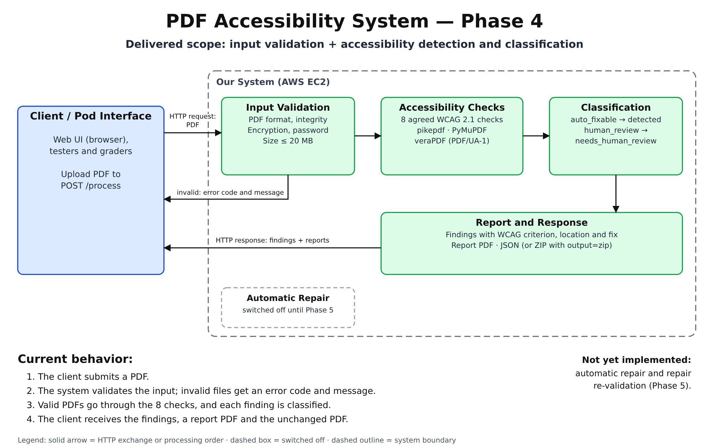
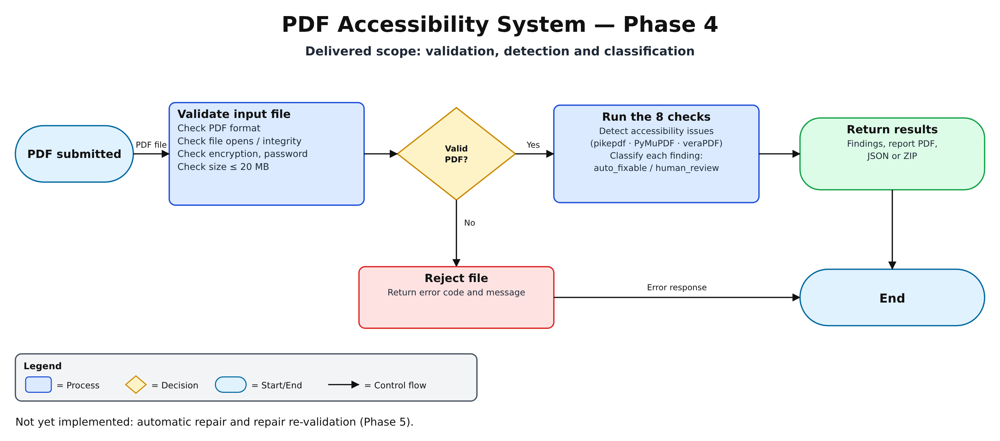

# AccessibilityProblemsChecker

Team 1 (West Lafayette, Pod D) implementation of the pod's shared PDF accessibility
service for the **ADA Title II Digital Accessibility Rule** (28 CFR §35.200, WCAG 2.1 AA).
`POST /process` runs all eight agreed checks, registered in `checks/__init__.py`:
non-text content and structure (`pdf_checks.py`), sensory, color and link
(Person 2), and title, language and headings (Person 3). Automatic repair remains
disabled by default (Phase 5). This README describes the system **as delivered at the
end of Phase 4**, which is the version deployed at the URLs below.

See [`checks/README.md`](checks/README.md) for each check, and
[Person 2 fixtures and tests](test_fixtures/person2/README.md) for the sensory,
color and link rules.

## Deployed services

| | URL |
|---|---|
| Web UI | http://3.15.117.84/system (also http://3.15.117.84/) |
| System base URL | http://3.15.117.84/system |
| System interactive docs | http://3.15.117.84/system/docs |
| Tester base URL | http://3.15.117.84/tester |
| Tester interactive docs | http://3.15.117.84/tester/docs |
| Pod specification (system contract) | [`openapi.yaml`](openapi.yaml), shared spec v0.4.0, agreed with Team 3 |
| Tester contract | [`tester/openapi.yaml`](tester/openapi.yaml) |

Opening the system base URL in a browser shows the web UI; the tester base URL opens
its docs page. Testers only call paths below the base URLs, so this does not affect
them. Everything runs on one AWS EC2 instance (t3.micro, Ubuntu 24.04, us-east-2,
Elastic IP) behind nginx, with veraPDF (Java) on the same instance; see
[Deployment](#deployment).

**Access / run notes (as in the registry):** no authentication. Base URLs have no
trailing slash. Maximum times: system `/test/setup` 10 s; tester `/test/setup` 15 s;
tester `/test/run` at most 14 project calls × 60 s plus 10 s for the target's
`/test/report` (≈ 15 min worst case); a normal run against our system takes a few seconds.

## Architecture

`POST /process` in Phase 4: nginx forwards `/system/...` to the FastAPI app, which
validates the upload (400/413/415/422), opens the PDF once into a shared check context
(pikepdf, PyMuPDF and one veraPDF PDF/UA-1 run), runs the eight registered checks in
catalog order, classifies each finding from `catalog.py`, locates it on its page
(`checks/locate.py`, `Location.bbox`), names any check that did not run in `limitations`,
builds the report PDF, and returns JSON (or one zip with `output=zip`). The React UI,
served by nginx, calls the same endpoint and highlights findings in a PDF viewer.





The Phase 3 versions of these models (validation only) are kept as `model.png` and
`model1.png` for comparison.

## System interface

The contract is `openapi.yaml` (OpenAPI 3.0.3, spec v0.4.0). Both pod teams build to
it, so if it changes, update it here, bump the version and send it to Team 3.

Project API:

| Endpoint | What it does |
|---|---|
| `GET /health` | `{"status": "ok", "spec_version": "0.4.0"}` |
| `GET /checks` | `{"checks": [...]}`, the 8 agreed checks (`check_id`, `name`, `wcag_criterion`, `wcag_level`, `classification`) |
| `POST /process` | Multipart upload: field `file` (the PDF), optional `session_id`, optional `output` (`json`, the default, or `zip`). Returns an `EvaluationResult` with findings (each with an optional `location.bbox`), the output PDF and a report PDF in Base64; with `output=zip`, one zip with `original.pdf`, the output PDF, the report PDF and `result.json` |

Course test endpoints:

| Endpoint | What it does |
|---|---|
| `POST /test/setup` | `{"session_id": "...", "setup": {}}` → 201 `{"session_id"}`; 409 if it already exists; 400 if invalid |
| `GET /test/report?session_id=...` | 200 with code coverage of this service during that session's `/process` calls; 400 without an ID; 404 for an unknown session |

### Models (`models.py`, snake_case, extra fields forbidden)

- **Check**: one of the 8 agreed checks, classified `auto_fixable` or `human_review`.
- **EvaluationResult**: `evaluation_id`, `status`, `input` (file name, SHA-256, size),
  `outcome`, `checks_performed`, `findings`, `repairs`, `new_issues_after_repair`,
  `human_review_items`, `summary` (counts), `limitations`, a fixed
  `compliance_statement` ("This report does not certify ADA Title II or WCAG 2.1
  conformance."), `output_pdf` and `report_pdf` (file name, media type, SHA-256,
  `modified`, Base64 content).
- **Finding / Repair / Location**: check results and locations; human-review findings never create repair records.
  `Location.bbox` (optional, nullable) is `[x0, y0, x1, y1]` on `page` in PDF user space, so a
  viewer can highlight the finding; `checks/locate.py` fills it where the position is known.
- **Error**: `{"status": "error", "error_code", "message"}` with codes `MISSING_FILE`,
  `INVALID_FILE_TYPE`, `FILE_TOO_LARGE`, `CORRUPTED_PDF`, `UNREADABLE_PDF`,
  `ENCRYPTED_PDF`, `PASSWORD_PROTECTED_PDF`, `INVALID_REQUEST` (an `output` value other than
  `json` or `zip`), `PROCESSING_ERROR`, `EXTERNAL_SERVICE_UNAVAILABLE`.
- **SessionRef / SystemReport / TestError**: the course test-interface bodies.

### What `/process` does now

The interface and upload validation are complete. All eight checks run on every
upload (see [`checks/README.md`](checks/README.md)); the image and structure checks are:

- **Input validation is complete:** no file → 400 `MISSING_FILE`; over 20 MB
  (20,971,520 bytes) → 413 `FILE_TOO_LARGE`; no `%PDF-` header in the first 1024 bytes
  → 415 `INVALID_FILE_TYPE`; corrupted, encrypted or password-protected → 422 with
  the matching code. Exactly 20 MB is accepted.
- **CHK-NONTEXT (1.1.1):** checks Figure `/Alt` descriptions and images drawn in page
  content, nested Form XObjects, and inline images. Resolves custom roles, MCIDs,
  page/stream scopes and image object references; ignores unused resources and
  explicitly marked `/Artifact` image uses. Missing Figure alternatives are `fail`;
  placeholder alternatives (e.g. "image1", "photo.jpg") and images without a resolvable
  alternative are `needs_review`.
- **CHK-STRUCTURE (1.3.1):** checks for a nonempty structure tree, the tagged-document
  marker, malformed relationships, and tagged tables with data cells but no headers.
  Missing/empty structure is `fail`; marker, relationship and header concerns are
  `needs_review`. Nested tables are inspected separately.
- Both checks have `classification: human_review`, `status: needs_human_review`,
  and finding IDs in `human_review_items`. They never trigger repairs.
- CHK-TITLE and CHK-LANG findings are `auto_fixable` and reported as `detected`;
  automatic repair is opt-in via `ENABLE_REPAIRS=true`. Without it the original PDF
  is returned byte-for-byte unchanged. JSON and report PDF include performed checks,
  findings, locations and limitations.
- PDFs are processed in memory and never stored.

## Tester (`tester/` folder)

A separate app that runs our test suite against **any** pod system (ours or Team 3's)
and returns the course suite report (results with pass / fail / error / skip and an
error source; code, component and system coverage).

| Endpoint | What it does |
|---|---|
| `POST /test/setup` | `{"target_url": "<system base URL>"}` → creates a session, calls the target's `/test/setup`, returns 201 `{"session_id"}` |
| `POST /test/run` | `{"session_id"}` → runs T-01 to T-14 once, reads the target's `/test/report`, returns the full report |
| `GET /test/report?session_id=...` | Returns the stored report (409 until the run ends) |

The 14 tests (`tester/suite.py`):

| Test | Checks | Acceptance criteria |
|---|---|---|
| T-01 | `GET /health` returns `status: ok` | — |
| T-02 | `GET /checks` returns the 8 agreed checks and classifications | — |
| T-03 | `goodAccessible.pdf` → 200, no findings or repairs, both PDFs returned | AC-01, AC-08 |
| T-04 | `accessibilityIssues.pdf` → 200, contract-conforming result | AC-01 |
| T-05 | No compliance claim; fixed non-certification statement | AC-09 |
| T-06 | `NonPDF.docx` → 415 `INVALID_FILE_TYPE` | AC-02 |
| T-07 | No file → 400 `MISSING_FILE` | AC-02 |
| T-08 | Corrupted PDF → 422 | AC-02 |
| T-09 | `encrypted.pdf` → 422 `ENCRYPTED_PDF` | AC-02 |
| T-10 | `passwordProtected.pdf` → 422 `PASSWORD_PROTECTED_PDF` | AC-02 |
| T-11 | 20 MB + 1 byte → 413 | AC-10 |
| T-12 | Exactly 20 MB → accepted | AC-10 |
| T-13 | `accessibilityIssues.pdf`: built-in issues found and classified (**Phase 4**) | AC-03, AC-04, AC-07 |
| T-14 | `accessibilityIssues.pdf`: title and language fixed and re-validated (**Phase 5**) | AC-05, AC-06, AC-08 |

Named files are the team's shared test set in `tester/fixtures/` (its README gives each
file's expected result); the no-file, corrupted and exact-size cases are generated in code.
Tests for later phases report `skip` until `CURRENT_PHASE` in `tester/suite.py` reaches them.

**Phase 4 result against our deployed system (Oct 31, 2026):** 13 pass, 0 fail, 1 skip
(T-14, repair, Phase 5); component coverage 6/8, system (acceptance-criteria) coverage
8/10. `contract_report.py` against the deployed system: all responses conform.
(Phase 3: 12 pass, 2 skip; 4/8 components, 5/10 acceptance criteria.)

## Known limitations

- **Partial detection:** image and structure checks use PDF tags and drawn content.
  They cannot establish image purpose, alternative-text accuracy, reading order,
  complete tagging or table semantics. Untagged tables and vector graphics are not
  inferred; presence of `/Alt` or `/TH` alone does not prove accessibility. `/ActualText`
  is not treated as a Figure `/Alt` replacement. Malformed/cyclic data produces review
  findings for incomplete inspection. Tree depth over 128, more than 100,000 structure
  nodes, or Form nesting over 64 also produces an incomplete-inspection finding.
- CHK-SENSORY and CHK-COLOR use English text cues and CHK-LINK does not visit link
  targets; these heuristics can miss issues or flag acceptable content. Automatic
  repair remains behind `ENABLE_REPAIRS` (off by default), so auto-fixable findings are
  reported as `detected` and the output PDF is the unchanged upload.
- **Scanned or image-only PDFs** are not really evaluated: there is no OCR, so the
  text-based checks find nothing on pages without a text layer.
- **Speed:** veraPDF adds about 2-4 s per `/process` call, and processing time grows
  with page count (about 4 ms per page). Very long documents (several thousand pages)
  approach the tester's 60 s per-call limit.
- **Highlights are best-effort:** `location.bbox` is null when only the page (or
  nothing) is known, e.g. document-level title and language findings.
- **Language tags** are checked for format only; a well-formed but wrong language is
  not detected.
- **All encrypted PDFs** are rejected with 422, including ones that open without a
  password (agreed spec behavior).
- **Not a compliance certification.** Results never certify ADA Title II / WCAG 2.1
  conformance; human-review items are never repaired automatically.
- **Sessions are in memory** (system and tester): they are lost when a service
  restarts, and system coverage measurement handles one measured request at a time.
- **HTTP only, no authentication**, single small EC2 instance: no HTTPS certificate,
  no rate limiting, no redundancy.
- **500 / 503 responses** are in the contract but cannot be triggered from outside,
  so they are not exercised by the tester or the conformance report.
- Uploads are limited to 20 MB (nginx allows 100 MB, so the 413 comes from the app as JSON).

## Code layout

- `main.py`: HTTP routes, error handling, request logging
- `pipeline.py`: input validation, runs the registered checks, findings, report PDF, gated repair
- `checks/`: the check registry and one module per check (see `checks/README.md`)
- `pdf_checks.py`: image and document/table structure inspection (CHK-NONTEXT, CHK-STRUCTURE)
- `checks/locate.py`: where each finding is on its page (`Location.bbox`), for the UI's highlight
- `catalog.py`: the 8 agreed checks
- `models.py`: request/response models matching `openapi.yaml`
- `sessions.py`: test sessions and per-session code coverage (coverage.py)
- `contract_report.py`: contract-conformance table for any deployed system
- `tester/app.py`: tester endpoints, sessions, report, coverage aggregation
- `tester/suite.py`: the 14 test cases
- `deploy/setup.sh`: EC2 install (venv, veraPDF, UI build, systemd services, nginx)
- `frontend/`: React + Vite web UI (upload, results, PDF viewer with highlights)
- `.github/workflows/ci.yml`: ruff, mypy, OpenAPI validation, pip-audit, pytest, conformance report, full tester run

## Focused check fixtures and tests

[`tester/fixtures/pdf_checks/README.md`](tester/fixtures/pdf_checks/README.md) lists
12 reproducible PDFs and their expected findings. Regenerate them with
`python tester/fixtures/pdf_checks/generate.py`; run the focused suite with
`python -m pytest test_pdf_checks.py`. Tests include malformed/cyclic tags and forms,
custom roles, MCID scoping, artifacts, repeated images, table nesting, response/report
contents, and mixed review findings with flagged automatic repairs.

With all eight checks registered and `CURRENT_PHASE = 4` in `tester/suite.py`, the
shared tester's full-detection test (T-13) runs and passes.

## Run locally

```bash
python3 -m venv .venv
source .venv/bin/activate            # Windows: .venv\Scripts\activate
python -m pip install -r requirements-dev.txt
python -m uvicorn main:app --port 8001                     # the system
cd tester && python -m uvicorn app:app --port 8002         # the tester (second terminal)
```

Then open `http://localhost:8001/docs`, or run the tester:

```bash
curl -X POST localhost:8002/test/setup -H 'content-type: application/json' \
     -d '{"target_url": "http://localhost:8001"}'
curl -X POST localhost:8002/test/run -H 'content-type: application/json' \
     -d '{"session_id": "<id from setup>"}'
```

## Tests and checks

```bash
python -m pytest                                           # system and tester unit tests
python contract_report.py http://3.15.117.84/system        # contract conformance (deployed)
```

## Deployment

On the EC2 instance, from the unzipped repo: `bash deploy/setup.sh`. It installs Python,
nginx, Java and veraPDF (`/opt/verapdf`), creates the venv, builds the React UI into
`/var/www/pdf-ui`, and sets up two systemd services (`pdf-system` on port 8001,
`pdf-tester` on 8002) that restart automatically. nginx maps `/system/` and `/tester/`
to them, serves the UI at `/system/ui/` (the bare `/system` redirects there) and at `/`,
with `client_max_body_size 100m` and a 900 s read timeout. The veraPDF and UI steps are
optional (`SKIP_VERAPDF=1`, `SKIP_UI=1`); if one fails, the API and tester still deploy.
Logs: `sudo journalctl -u pdf-system -u pdf-tester`.

Lambda/API Gateway is not used: its payload limits (6 MB / 10 MB) are below 20 MB.
