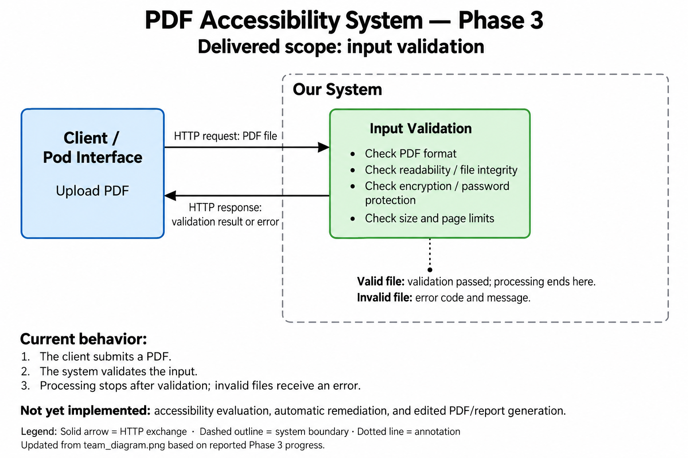
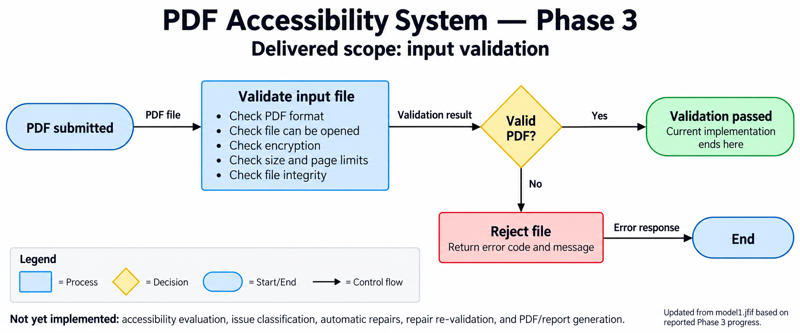

# AccessibilityProblemsChecker

Team 1 (West Lafayette, Pod D) implementation of the pod's shared PDF accessibility
service for the **ADA Title II Digital Accessibility Rule** (28 CFR §35.200, WCAG 2.1 AA).
This README describes the Phase 3 interface plus the implemented image and structure checks.

## Deployed services

| | URL |
|---|---|
| System base URL | http://3.15.117.84/system |
| System interactive docs | http://3.15.117.84/system/docs |
| Tester base URL | http://3.15.117.84/tester |
| Tester interactive docs | http://3.15.117.84/tester/docs |
| Pod specification (system contract) | [`openapi.yaml`](openapi.yaml), shared spec v0.3.0, agreed with Team 3 |
| Tester contract | [`tester/openapi.yaml`](tester/openapi.yaml) |

Opening a base URL in a browser redirects to its docs page. Both apps run on one AWS
EC2 instance (t3.micro, Ubuntu 24.04, us-east-2, Elastic IP) behind nginx; see
[Deployment](#deployment).

**Access / run notes (as in the registry):** no authentication. Base URLs have no
trailing slash. Maximum times: system `/test/setup` 10 s; tester `/test/setup` 15 s;
tester `/test/run` at most 14 project calls × 60 s plus 10 s for the target's
`/test/report` (≈ 15 min worst case); a normal run against our system takes a few seconds.

## Architecture (Phase 3)





## System interface

The contract is `openapi.yaml` (OpenAPI 3.0.3, spec v0.3.0). Both pod teams build to
it, so if it changes, update it here, bump the version and send it to Team 3.

Project API:

| Endpoint | What it does |
|---|---|
| `GET /health` | `{"status": "ok", "spec_version": "0.3.0"}` |
| `GET /checks` | `{"checks": [...]}`, the 8 agreed checks (`check_id`, `name`, `wcag_criterion`, `wcag_level`, `classification`) |
| `POST /process` | Multipart upload: field `file` (the PDF) and optional `session_id`. Returns an `EvaluationResult` with the output PDF and a report PDF in Base64 |

Course test endpoints:

| Endpoint | What it does |
|---|---|
| `POST /test/setup` | `{"session_id": "...", "setup": {}}` → 201 `{"session_id"}`; 409 if it already exists; 400 if invalid |
| `GET /test/report?session_id=...` | 200 with code coverage of this service during that session's `/process` calls; 400 without an ID; 404 for an unknown session |

### Models (`models.py`, snake_case, extra fields forbidden)

- **Check**: one of the 8 agreed checks, classified `auto_fixable` or `human_review`.
- **EvaluationResult**: `evaluation_id`, `status`, `input` (file name, SHA-256, size),
  `outcome`, `checks_performed`, `findings`, `repairs`, `new_issues_after_repair`,
  `human_review_items`, `summary` (counts), `limitations`, a fixed
  `compliance_statement` ("This report does not certify ADA Title II or WCAG 2.1
  conformance."), `output_pdf` and `report_pdf` (file name, media type, SHA-256,
  `modified`, Base64 content).
- **Finding / Repair / Location**: check results and locations; human-review findings never create repair records.
- **Error**: `{"status": "error", "error_code", "message"}` with codes `MISSING_FILE`,
  `INVALID_FILE_TYPE`, `FILE_TOO_LARGE`, `CORRUPTED_PDF`, `UNREADABLE_PDF`,
  `ENCRYPTED_PDF`, `PASSWORD_PROTECTED_PDF`, `PROCESSING_ERROR`, `EXTERNAL_SERVICE_UNAVAILABLE`.
- **SessionRef / SystemReport / TestError**: the course test-interface bodies.

### What `/process` does now

The interface and upload validation are complete. CHK-NONTEXT and CHK-STRUCTURE
run on every upload; the remaining checks are incomplete or disabled.

- **Input validation is complete:** no file → 400 `MISSING_FILE`; over 20 MB
  (20,971,520 bytes) → 413 `FILE_TOO_LARGE`; no `%PDF-` header in the first 1024 bytes
  → 415 `INVALID_FILE_TYPE`; corrupted, encrypted or password-protected → 422 with
  the matching code. Exactly 20 MB is accepted.
- **CHK-NONTEXT (1.1.1):** checks Figure `/Alt` descriptions and images drawn in page
  content, nested Form XObjects, and inline images. Resolves custom roles, MCIDs,
  page/stream scopes and image object references; ignores unused resources and
  explicitly marked `/Artifact` image uses. Missing Figure alternatives are `fail`;
  images without a resolvable alternative are `needs_review`.
- **CHK-STRUCTURE (1.3.1):** checks for a nonempty structure tree, the tagged-document
  marker, malformed relationships, and tagged tables with data cells but no headers.
  Missing/empty structure is `fail`; marker, relationship and header concerns are
  `needs_review`. Nested tables are inspected separately.
- Both checks have `classification: human_review`, `status: needs_human_review`,
  and finding IDs in `human_review_items`. They never trigger repairs. The original
  PDF is returned byte-for-byte unchanged unless flagged title/language repair runs.
  JSON and report PDF include performed checks, findings, locations and limitations.
- Title/language detection and repair remain opt-in via `ENABLE_TITLE_LANG_CHECKS=true`.
  `checks_performed` lists only enabled checks; disabled checks appear in limitations.
- PDFs are processed in memory and never stored.

## Tester (`tester/` folder)

A separate app that runs our test suite against **any** pod system (ours or Team 3's)
and returns the course suite report (results with pass / fail / error / skip and an
error source; code, component and system coverage).

| Endpoint | What it does |
|---|---|
| `POST /test/setup` | `{"target_url": "<system base URL>"}` → creates a session, calls the target's `/test/setup`, returns 201 `{"session_id"}` |
| `POST /test/run` | `{"session_id"}` → runs T-01 to T-14 once, reads the target's `/test/report`, returns the full report |
| `GET /test/report?session_id=...` | Returns the stored report (409 until the run ends) |

The 14 tests (`tester/suite.py`):

| Test | Checks | Acceptance criteria |
|---|---|---|
| T-01 | `GET /health` returns `status: ok` | — |
| T-02 | `GET /checks` returns the 8 agreed checks and classifications | — |
| T-03 | `goodAccessible.pdf` → 200, no findings or repairs, both PDFs returned | AC-01, AC-08 |
| T-04 | `accessibilityIssues.pdf` → 200, contract-conforming result | AC-01 |
| T-05 | No compliance claim; fixed non-certification statement | AC-09 |
| T-06 | `NonPDF.docx` → 415 `INVALID_FILE_TYPE` | AC-02 |
| T-07 | No file → 400 `MISSING_FILE` | AC-02 |
| T-08 | Corrupted PDF → 422 | AC-02 |
| T-09 | `encrypted.pdf` → 422 `ENCRYPTED_PDF` | AC-02 |
| T-10 | `passwordProtected.pdf` → 422 `PASSWORD_PROTECTED_PDF` | AC-02 |
| T-11 | 20 MB + 1 byte → 413 | AC-10 |
| T-12 | Exactly 20 MB → accepted | AC-10 |
| T-13 | `accessibilityIssues.pdf`: built-in issues found and classified (**Phase 4**) | AC-03, AC-04, AC-07 |
| T-14 | `accessibilityIssues.pdf`: title and language fixed and re-validated (**Phase 5**) | AC-05, AC-06, AC-08 |

Named files are the team's shared test set in `tester/fixtures/` (its README gives each
file's expected result); the no-file, corrupted and exact-size cases are generated in code.
Tests for later phases report `skip` until `CURRENT_PHASE` in `tester/suite.py` reaches them.

**Historical Phase 3 result against our deployed system:** 12 pass, 2 skip (T-13, T-14);
component coverage 4/8, system (acceptance-criteria) coverage 5/10.

## Known limitations

- **Partial detection:** image and structure checks use PDF tags and drawn content.
  They cannot establish image purpose, alternative-text accuracy, reading order,
  complete tagging or table semantics. Untagged tables and vector graphics are not
  inferred; presence of `/Alt` or `/TH` alone does not prove accessibility. `/ActualText`
  is not treated as a Figure `/Alt` replacement. Malformed/cyclic data produces review
  findings for incomplete inspection. Tree depth over 128, more than 100,000 structure
  nodes, or Form nesting over 64 also produces an incomplete-inspection finding.
- CHK-SENSORY, CHK-COLOR, CHK-LINK and CHK-HEADINGS are unimplemented. Title/language
  detection and repair remain behind `ENABLE_TITLE_LANG_CHECKS` (off by default).
- **Not a compliance certification.** Results never certify ADA Title II / WCAG 2.1
  conformance; human-review items are never repaired automatically.
- **Sessions are in memory** (system and tester): they are lost when a service
  restarts, and system coverage measurement handles one measured request at a time.
- **HTTP only, no authentication**, single small EC2 instance: no HTTPS certificate,
  no rate limiting, no redundancy.
- **500 / 503 responses** are in the contract but cannot be triggered from outside,
  so they are not exercised by the tester or the conformance report.
- Uploads are limited to 20 MB (nginx allows 25 MB so the 413 comes from the app).

## Code layout

- `main.py`: HTTP routes, error handling, request logging
- `pipeline.py`: input validation, findings, report PDF, gated title/language repair
- `pdf_checks.py`: image and document/table structure inspection
- `catalog.py`: the 8 agreed checks
- `models.py`: request/response models matching `openapi.yaml`
- `sessions.py`: test sessions and per-session code coverage (coverage.py)
- `contract_report.py`: contract-conformance table for any deployed system
- `tester/app.py`: tester endpoints, sessions, report, coverage aggregation
- `tester/suite.py`: the 14 test cases
- `deploy/setup.sh`: EC2 install (venv, systemd services, nginx)
- `.github/workflows/ci.yml`: ruff, mypy, OpenAPI validation, pip-audit, pytest, conformance report, full tester run

## Focused check fixtures and tests

[`tester/fixtures/pdf_checks/README.md`](tester/fixtures/pdf_checks/README.md) lists
12 reproducible PDFs and their expected findings. Regenerate them with
`python tester/fixtures/pdf_checks/generate.py`; run the focused suite with
`python -m pytest test_pdf_checks.py`. Tests include malformed/cyclic tags and forms,
custom roles, MCID scoping, artifacts, repeated images, table nesting, response/report
contents, and mixed review findings with flagged automatic repairs.

The shared cross-team tester remains in Phase 3: T-13 requires other unimplemented
checks too. Its phase and shared fixtures have not changed.

## Run locally

```bash
python3 -m venv .venv
source .venv/bin/activate            # Windows: .venv\Scripts\activate
python -m pip install -r requirements-dev.txt
python -m uvicorn main:app --port 8001                     # the system
cd tester && python -m uvicorn app:app --port 8002         # the tester (second terminal)
```

Then open `http://localhost:8001/docs`, or run the tester:

```bash
curl -X POST localhost:8002/test/setup -H 'content-type: application/json' \
     -d '{"target_url": "http://localhost:8001"}'
curl -X POST localhost:8002/test/run -H 'content-type: application/json' \
     -d '{"session_id": "<id from setup>"}'
```

## Tests and checks

```bash
python -m pytest                                           # system and tester unit tests
python contract_report.py http://3.15.117.84/system        # contract conformance (deployed)
```

## Deployment

On the EC2 instance, from the unzipped repo: `bash deploy/setup.sh`. It installs Python
and nginx, creates the venv, and sets up two systemd services (`pdf-system` on port
8001, `pdf-tester` on 8002) that restart automatically. nginx maps `/system/` and
`/tester/` to them, with `client_max_body_size 25m` and a 900 s read timeout.
Logs: `sudo journalctl -u pdf-system -u pdf-tester`.

Lambda/API Gateway is not used: its payload limits (6 MB / 10 MB) are below 20 MB.
