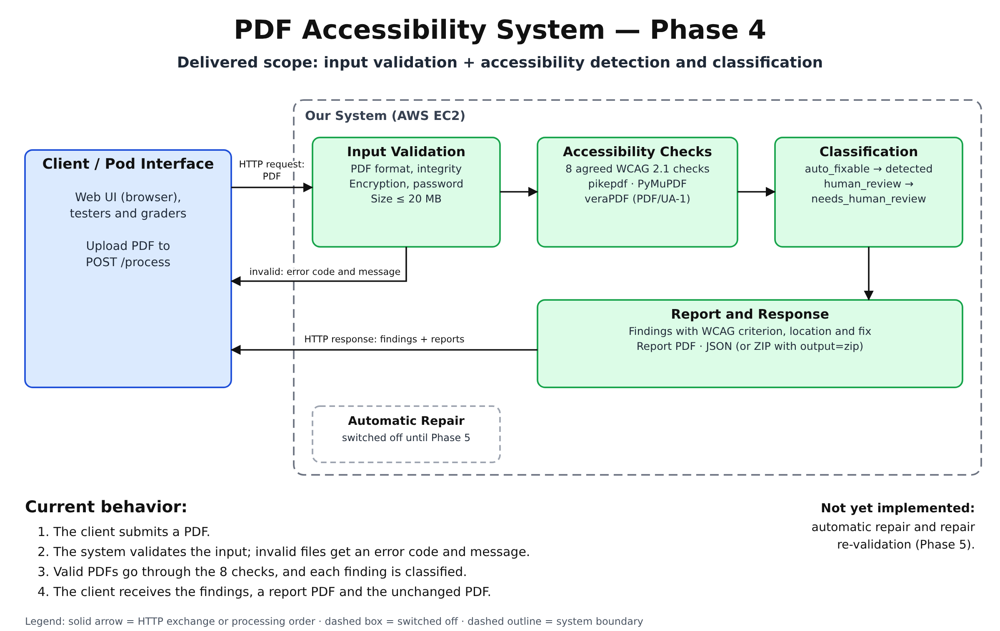
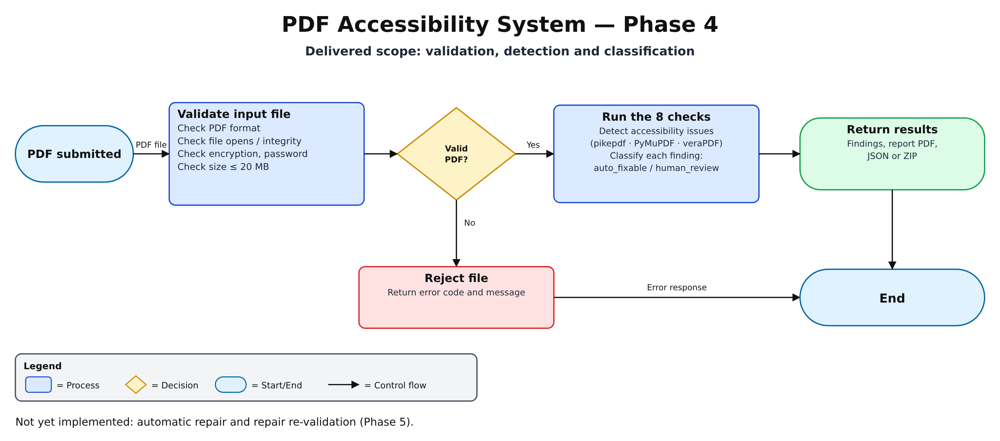

# AccessibilityProblemsChecker

Team 1 (West Lafayette, Pod D) implementation of the pod's shared PDF accessibility
service for the **ADA Title II Digital Accessibility Rule** (28 CFR §35.200, WCAG 2.1 AA).
`POST /process` runs all eight agreed checks, registered in `checks/__init__.py`:
non-text content and structure (`pdf_checks.py`), sensory, color and link
(Person 2), and title, language and headings (Person 3). **Phase 5 (in progress):**
automatic repair is on, with the repair framework in `remediation/` and the title and
language repairs done (see [Automatic repair](#automatic-repair-phase-5)). Other parts
of this README describe the system as delivered at the end of Phase 4 until Phase 5
is deployed.

See [`checks/README.md`](checks/README.md) for each check, and
[Person 2 fixtures and tests](test_fixtures/person2/README.md) for the sensory,
color and link rules.

## Deployed services

| | URL |
|---|---|
| Web UI | http://3.15.117.84/system (also http://3.15.117.84/) |
| System base URL | http://3.15.117.84/system |
| System interactive docs | http://3.15.117.84/system/docs |
| Tester base URL | http://3.15.117.84/tester |
| Tester interactive docs | http://3.15.117.84/tester/docs |
| Pod specification (system contract) | [`openapi.yaml`](openapi.yaml), shared spec v0.5.0, agreed with Team 3 |
| Tester contract | [`tester/openapi.yaml`](tester/openapi.yaml) |

Opening the system base URL in a browser shows the web UI; the tester base URL opens
its docs page. Testers only call paths below the base URLs, so this does not affect
them. Everything runs on one AWS EC2 instance (t3.micro, Ubuntu 24.04, us-east-2,
Elastic IP) behind nginx, with veraPDF (Java) on the same instance; see
[Deployment](#deployment).

**Access / run notes (as in the registry):** no authentication. Base URLs have no
trailing slash. Maximum times: system `/test/setup` 10 s; tester `/test/setup` 15 s;
tester `/test/run` at most 25 project calls × 60 s plus 10 s for the target's
`/test/report` (≈ 25 min worst case); a normal run against our system takes under a minute.

## Architecture

`POST /process` in Phase 4: nginx forwards `/system/...` to the FastAPI app, which
validates the upload (400/413/415/422), opens the PDF once into a shared check context
(pikepdf, PyMuPDF and one veraPDF PDF/UA-1 run), runs the eight registered checks in
catalog order, classifies each finding from `catalog.py`, locates it on its page
(`checks/locate.py`, `Location.bbox`), names any check that did not run in `limitations`,
builds the report PDF, and returns JSON (or one zip with `output=zip`). The React UI,
served by nginx, calls the same endpoint and highlights findings in a PDF viewer.





The Phase 3 versions of these models (validation only) are kept as `model.png` and
`model1.png` for comparison.

## System interface

The contract is `openapi.yaml` (OpenAPI 3.0.3, spec v0.5.0). Both pod teams build to
it, so if it changes, update it here, bump the version and send it to Team 3.

Project API:

| Endpoint | What it does |
|---|---|
| `GET /health` | `{"status": "ok", "spec_version": "0.5.0"}` |
| `GET /checks` | `{"checks": [...]}`, the 8 agreed checks (`check_id`, `name`, `wcag_criterion`, `wcag_level`, `classification`) |
| `POST /process` | Multipart upload: field `file` (the PDF), optional `session_id`, optional `output` (`json`, the default, or `zip`). Returns an `EvaluationResult` with findings (each with an optional `location.bbox`), the output PDF and a report PDF in Base64; with `output=zip`, one zip with `original.pdf`, the output PDF, the report PDF and `result.json` |

Course test endpoints:

| Endpoint | What it does |
|---|---|
| `POST /test/setup` | `{"session_id": "...", "setup": {}}` → 201 `{"session_id"}`; 409 if it already exists; 400 if invalid |
| `GET /test/report?session_id=...` | 200 with code coverage of this service during that session's `/process` calls; 400 without an ID; 404 for an unknown session |

### Models (`models.py`, snake_case, extra fields forbidden)

- **Check**: one of the 8 agreed checks, classified `auto_fixable` or `human_review`.
- **EvaluationResult**: `evaluation_id`, `status`, `input` (file name, SHA-256, size),
  `outcome`, `checks_performed`, `findings`, `repairs`, `new_issues_after_repair`,
  `human_review_items`, `summary` (counts), `limitations`, a fixed
  `compliance_statement` ("This report does not certify ADA Title II or WCAG 2.1
  conformance."), `output_pdf` and `report_pdf` (file name, media type, SHA-256,
  `modified`, Base64 content).
- **Finding / Repair / Location**: check results and locations. Optional (spec v0.5.0):
  `Finding.suggested_text` and `suggestion_source` (`rule` or `llm`) give the concrete
  proposed text; `Repair.method` (`rule` or `llm`) and `applied_text` say what was written.
  `Location.bbox` (optional, nullable) is `[x0, y0, x1, y1]` on `page` in PDF user space, so a
  viewer can highlight the finding; `checks/locate.py` fills it where the position is known.
- **Error**: `{"status": "error", "error_code", "message"}` with codes `MISSING_FILE`,
  `INVALID_FILE_TYPE`, `FILE_TOO_LARGE`, `CORRUPTED_PDF`, `UNREADABLE_PDF`,
  `ENCRYPTED_PDF`, `PASSWORD_PROTECTED_PDF`, `NO_TEXT_LAYER`, `INVALID_REQUEST` (an `output` value other than
  `json` or `zip`), `PROCESSING_ERROR`, `EXTERNAL_SERVICE_UNAVAILABLE`.
- **SessionRef / SystemReport / TestError**: the course test-interface bodies.

### What `/process` does now

The interface and upload validation are complete. All eight checks run on every
upload (see [`checks/README.md`](checks/README.md)); the image and structure checks are:

- **Input validation is complete:** no file → 400 `MISSING_FILE`; over 20 MB
  (20,971,520 bytes) → 413 `FILE_TOO_LARGE`; no `%PDF-` header in the first 1024 bytes
  → 415 `INVALID_FILE_TYPE`; corrupted, encrypted or password-protected → 422 with
  the matching code. Exactly 20 MB is accepted.
- **CHK-NONTEXT (1.1.1):** checks Figure `/Alt` descriptions and images drawn in page
  content, nested Form XObjects, and inline images. Resolves custom roles, MCIDs,
  page/stream scopes and image object references; ignores unused resources and
  explicitly marked `/Artifact` image uses. Missing Figure alternatives are `fail`;
  placeholder alternatives (e.g. "image1", "photo.jpg") and images without a resolvable
  alternative are `needs_review`.
- **CHK-STRUCTURE (1.3.1):** checks for a nonempty structure tree, the tagged-document
  marker, malformed relationships, and tagged tables with data cells but no headers.
  Missing/empty structure is `fail`; marker, relationship and header concerns are
  `needs_review`. Nested tables are inspected separately.
- Both checks have `classification: human_review`, `status: needs_human_review`,
  and finding IDs in `human_review_items`. CHK-STRUCTURE provides rule-based suggestions only. CHK-NONTEXT can write AI-drafted alt text or mark an image as an artifact; its findings remain unresolved for human review.
- CHK-TITLE and CHK-LANG findings are `auto_fixable` and are repaired automatically
  (next section); they become `fixed` or `repair_failed`. With `ENABLE_REPAIRS=false`
  they are reported as `detected` and the original PDF is returned byte-for-byte
  unchanged. JSON and report PDF include performed checks, findings, locations,
  repairs and limitations.
- PDFs are processed in memory and never stored.

### Automatic repair (Phase 5)

Repairs run on a copy of the upload (the upload itself is never changed). Then
**every check runs again on the repaired PDF**: a repair passes re-validation when its
issue (same check, type and place) is gone, and anything the repairs introduced is
listed in `new_issues_after_repair`. Object numbers change when a PDF is saved, so
before/after findings are matched by walking both files side by side
(`pipeline.object_number_map`).

| Check | Issue | Repair |
|---|---|---|
| CHK-TITLE | missing title, placeholder or file-name title | New title in Info `/Title` and XMP `dc:title`: an AI suggestion from page 1 if an LLM is set up, else the largest heading on page 1, else the cleaned file name |
| CHK-TITLE | title only in Info, not XMP | Copies it into XMP `dc:title` (other Info fields are kept) |
| CHK-TITLE | `DisplayDocTitle` not set | Sets `ViewerPreferences/DisplayDocTitle` to true |
| CHK-LANG | missing or invalid document language | Corrects a broken tag (`en_US` → `en-US`, `English` → `en`), else detects the language from the text (`langdetect`, offline), else assumes `en-US` and says so in `limitations` |
| CHK-LANG | invalid passage language | Corrects the tag, or removes it so the passage uses the document language |

- **auto_fixable** findings become `fixed` or `repair_failed`. **human_review** findings
  are never resolved automatically: a repair can be recorded for them (for example
  AI-drafted alt text), but they stay `needs_human_review` (spec v0.5.0).
- **AI text** (`method: "llm"`) is labeled "AI-generated, please verify" in the
  repairs and the report PDF, and `limitations` says the text was sent to an external
  model provider. If the LLM is missing, slow or fails, the rule-based fallback is used
  and noted; an LLM problem never fails the request.
- CHK-HEADINGS findings (human review) carry rule-based `suggested_text` where the fix
  is clear: the right heading level (`H1`, `H3`), or a form label from the field name
  (`first_name` → "First name").
- Adding a repair, and the `llm.py` functions the AI hook expects:
  [`remediation/README.md`](remediation/README.md).

- **Safety checks:** if the repaired PDF cannot be saved, reopened or re-checked, all
  repairs are discarded and the original is returned (noted in `limitations`). When
  veraPDF ran, PDF/UA-1 rules that fail only after repair are listed in `limitations`.
- The report PDF and the web UI show a before/after summary, every repair with its
  re-check result, AI labels, and any new issues after repair.

### AI suggestions (`llm.py`)

Every LLM call goes through `llm.py` (via `remediation/ai.py`), using an
OpenAI-compatible API: by default OpenRouter's free `google/gemma-4-26b-a4b:free`,
falling back to `nvidia/nemotron-3.5-super-vl:free`. Functions: `suggest_title`
(used now), `describe_image` (used for image repairs), `suggest_link_text` and `rewrite_sentence` (ready for
the CHK-NONTEXT, CHK-LINK, CHK-COLOR and CHK-SENSORY repairs and suggestions).

- **No key, no AI:** without `LLM_API_KEY` every call returns nothing and the
  rule-based fallbacks are used, so CI and the tests never need an LLM. `LLM_MOCK=true`
  gives fixed fake answers without a network (demos, UI work).
- **Limits:** 20 calls/minute and 50/day (OpenRouter free tier), at most 8 calls and
  25 s of model time per uploaded PDF, a 15 s timeout per call, one retry, then the
  fallback model, then the rule-based text. Over a limit, calls are skipped, not queued.
- **Cache:** answers are cached by a SHA-256 of the task and its inputs, in memory and
  in `LLM_CACHE_DIR` (`/var/cache/pdf-system` on EC2), so repeated tester runs cost
  no requests.
- **Privacy:** on OpenRouter, requests ask for providers that do not collect data
  (`provider.data_collection: "deny"`, `LLM_DATA_COLLECTION`). If no free provider
  qualifies, calls fail and the fallbacks are used; setting `allow` sends document
  text to providers that may keep it. Document text is sent as content, never as
  instructions, and every answer is cleaned and length-limited before use.
- **The key** is never in the repository: on EC2 it goes in `/etc/pdf-system.env`
  (root-only, created by `deploy/setup.sh`); then `sudo systemctl restart pdf-system`.

Environment variables: `ENABLE_REPAIRS=false` switches repair off (Phase 4 behaviour);
`LLM_ENABLED=false` switches the AI suggestions off (rule-based fallbacks only); every
`LLM_*` setting is listed at the top of `llm.py`.

## Tester (`tester/` folder)

A separate app that runs our test suite against **any** pod system (ours or Team 3's)
and returns the course suite report (results with pass / fail / error / skip and an
error source; code, component and system coverage).

| Endpoint | What it does |
|---|---|
| `POST /test/setup` | `{"target_url": "<system base URL>"}` → creates a session, calls the target's `/test/setup`, returns 201 `{"session_id"}` |
| `POST /test/run` | `{"session_id"}` → runs T-01 to T-25 once, reads the target's `/test/report`, returns the full report |
| `GET /test/report?session_id=...` | Returns the stored report (409 until the run ends) |

The 25 tests (`tester/suite.py`):

| Test | Checks | Acceptance criteria |
|---|---|---|
| T-01 | `GET /health` returns `status: ok` | — |
| T-02 | `GET /checks` returns the 8 agreed checks and classifications | — |
| T-03 | `goodAccessible.pdf` → 200, no findings or repairs, both PDFs returned | AC-01, AC-08 |
| T-04 | `accessibilityIssues.pdf` → 200, contract-conforming result | AC-01 |
| T-05 | No compliance claim; fixed non-certification statement | AC-09 |
| T-06 | `NonPDF.docx` → 415 `INVALID_FILE_TYPE` | AC-02 |
| T-07 | No file → 400 `MISSING_FILE` | AC-02 |
| T-08 | Corrupted PDF → 422 | AC-02 |
| T-09 | `encrypted.pdf` → 422 `ENCRYPTED_PDF` | AC-02 |
| T-10 | `passwordProtected.pdf` → 422 `PASSWORD_PROTECTED_PDF` | AC-02 |
| T-11 | 20 MB + 1 byte → 413 | AC-10 |
| T-12 | Exactly 20 MB → accepted | AC-10 |
| T-13 | `accessibilityIssues.pdf`: built-in issues found and classified (**Phase 4**) | AC-03, AC-04, AC-07 |
| T-14 | `accessibilityIssues.pdf`: title and language fixed and re-validated (**Phase 5**) | AC-05, AC-06, AC-08 |
| T-15 | `pdf_checks/combined.pdf`: figure without alt text and table without headers found on page 1, human_review | AC-03, AC-04, AC-07 |
| T-16 | `pdf_checks/inline_image.pdf`: inline image without a text alternative found | AC-03, AC-04, AC-07 |
| T-17 | `person2/combined_review.pdf`: sensory, color and link findings on page 2, human_review | AC-03, AC-04, AC-07 |
| T-18 | `person2/link_empty.pdf`: link with no label found | AC-03, AC-04, AC-07 |
| T-19 | Generated tagged PDF: placeholder title, invalid language (auto_fixable), heading and form-label problems (human_review) | AC-03, AC-04, AC-07 |
| T-20 | `output=zip`: original, output PDF, report PDF and `result.json`, all matching | AC-01, AC-09 |
| T-21 | `output=xml` → 400 `INVALID_REQUEST` | AC-02 |
| T-22 | Generated picture-only PDF (no text layer) → 422 `NO_TEXT_LAYER` (**Phase 5**) | AC-02 |
| T-23 | Generated PDF, page 1 text + page 2 scanned → processed, page 2 named in `limitations`, no text-based findings on it (**Phase 5**) | AC-03 |
| T-24 | `accessibilityIssues.pdf`: spec v0.5.0 repair rules (method/source values, repaired human-review items stay unresolved, `fixed_count`, `modified`); never compares AI text (**Phase 5**) | AC-04, AC-06, AC-07 |
| T-25 | Generated tagged PDF: `/Lang` "en_US" and title "Untitled" repaired to a valid tag and a real title, re-validated (**Phase 5**) | AC-05, AC-06 |

Named files are the team's shared test set in `tester/fixtures/` (its README gives each
file's expected result); the no-file, corrupted and exact-size cases are generated in code.
Tests for later phases report `skip` until `CURRENT_PHASE` in `tester/suite.py` reaches them.

**Code coverage** (reported by the system's `/test/report`) counts coverage.py
statements of the service's modules (`main.py`, `pipeline.py`, `models.py`,
`catalog.py`, `sessions.py`, `pdf_checks.py`, `checks/*.py`) that ran for the session:
lines run while handling its `/process` requests, plus lines that run when those modules
load (imports, definitions, models), measured once at startup in a clean interpreter.
`contract_report.py` is a standalone script, not part of the service, so it is not counted.

**Phase 5 so far, local run (Nov 13, 2026, without veraPDF):** 21 pass, 0 fail, 0 skip
(T-14 now runs and passes); component coverage 8/8, system coverage 10/10, code
coverage 1435/1837. Rerun against the deployed system once Phase 5 is deployed.

**Phase 4 result against our deployed system (Oct 31, 2026):** 13 pass, 0 fail, 1 skip
(T-14, repair, Phase 5); component coverage 6/8, system (acceptance-criteria) coverage
8/10. `contract_report.py` against the deployed system: all responses conform.
(Phase 3: 12 pass, 2 skip; 4/8 components, 5/10 acceptance criteria.)

## Known limitations

- **Partial detection:** image and structure checks use PDF tags and drawn content.
  They cannot establish image purpose, alternative-text accuracy, reading order,
  complete tagging or table semantics. Untagged tables and vector graphics are not
  inferred; presence of `/Alt` or `/TH` alone does not prove accessibility. `/ActualText`
  is not treated as a Figure `/Alt` replacement. Malformed/cyclic data produces review
  findings for incomplete inspection. Tree depth over 128, more than 100,000 structure
  nodes, or Form nesting over 64 also produces an incomplete-inspection finding.
- CHK-SENSORY and CHK-COLOR use English text cues and CHK-LINK does not visit link
  targets; these heuristics can miss issues or flag acceptable content.
- **Repairs cover CHK-TITLE, CHK-LANG and bounded CHK-NONTEXT image repairs** (Phase 5 in progress). A rule-based
  title is only as good as page 1's largest heading or the file name, and a language
  detected from very little text is assumed (`en-US`) and flagged for review. An
  auto-fixable finding with no repair (e.g. veraPDF's `text_language_not_determinable`)
  stays `detected`.
- **Textless PDFs**, including blank files, return 422 `NO_TEXT_LAYER`. Mixed PDFs
  are accepted with scanned pages listed in limitations. OCR is out of scope.
- **Speed:** veraPDF adds about 2-4 s per `/process` call, and processing time grows
  with page count (about 4 ms per page). Very long documents (several thousand pages)
  approach the tester's 60 s per-call limit.
- **Highlights are best-effort:** `location.bbox` is null when only the page (or
  nothing) is known, e.g. document-level title and language findings.
- **Language tags** are checked for format only; a well-formed but wrong language is
  not detected.
- **All encrypted PDFs** are rejected with 422, including ones that open without a
  password (agreed spec behavior).
- **Not a compliance certification.** Results never certify ADA Title II / WCAG 2.1
  conformance; human-review items are never resolved automatically.
- **Sessions are in memory** (system and tester): they are lost when a service
  restarts, and system coverage measurement handles one measured request at a time.
- **HTTP only, no authentication**, single small EC2 instance: no HTTPS certificate,
  no rate limiting, no redundancy.
- **500 / 503 responses** are in the contract but cannot be triggered from outside,
  so they are not exercised by the tester or the conformance report.
- Uploads are limited to 20 MB (nginx allows 100 MB, so the 413 comes from the app as JSON).

## Code layout

- `main.py`: HTTP routes, error handling, request logging
- `pipeline.py`: input validation, runs the registered checks, repair and re-validation, findings, report PDF
- `llm.py`: the shared LLM client (configuration, limits, cache, retries, mock mode)
- `remediation/`: the repair registry and one module per repaired check (`title.py`, `lang.py`), plus `ai.py`, the single hook for LLM text (see `remediation/README.md`)
- `checks/`: the check registry and one module per check (see `checks/README.md`)
- `pdf_checks.py`: image and document/table structure inspection (CHK-NONTEXT, CHK-STRUCTURE)
- `checks/locate.py`: where each finding is on its page (`Location.bbox`), for the UI's highlight
- `catalog.py`: the 8 agreed checks
- `models.py`: request/response models matching `openapi.yaml`
- `sessions.py`: test sessions and per-session code coverage (coverage.py)
- `contract_report.py`: contract-conformance table for any deployed system
- `tester/app.py`: tester endpoints, sessions, report, coverage aggregation
- `tester/suite.py`: the 25 test cases (`CURRENT_PHASE = 5`)
- `deploy/setup.sh`: EC2 install (venv, veraPDF, UI build, systemd services, nginx)
- `frontend/`: React + Vite web UI (upload, results, PDF viewer with highlights)
- `.github/workflows/ci.yml`: ruff, mypy, OpenAPI validation, pip-audit, pytest, conformance report, full tester run

## Focused check fixtures and tests

[`tester/fixtures/pdf_checks/README.md`](tester/fixtures/pdf_checks/README.md) lists
12 reproducible PDFs and their expected findings. Regenerate them with
`python tester/fixtures/pdf_checks/generate.py`; run the focused suite with
`python -m pytest test_pdf_checks.py`. Tests include malformed/cyclic tags and forms,
custom roles, MCID scoping, artifacts, repeated images, table nesting, response/report
contents, and mixed review findings with flagged automatic repairs.

With all eight checks registered and `CURRENT_PHASE = 5` in `tester/suite.py`, the
shared tester's full-detection test (T-13) and repair test (T-14) run and pass.

## Run locally

```bash
python3 -m venv .venv
source .venv/bin/activate            # Windows: .venv\Scripts\activate
python -m pip install -r requirements-dev.txt
python -m uvicorn main:app --port 8001                     # the system
cd tester && python -m uvicorn app:app --port 8002         # the tester (second terminal)
```

Then open `http://localhost:8001/docs`, or run the tester:

```bash
curl -X POST localhost:8002/test/setup -H 'content-type: application/json' \
     -d '{"target_url": "http://localhost:8001"}'
curl -X POST localhost:8002/test/run -H 'content-type: application/json' \
     -d '{"session_id": "<id from setup>"}'
```

## Tests and checks

```bash
python -m pytest                                           # system and tester unit tests
python contract_report.py http://3.15.117.84/system        # contract conformance (deployed)
```

## Deployment

On the EC2 instance, from the unzipped repo: `bash deploy/setup.sh`. It installs Python,
nginx, Java and veraPDF (`/opt/verapdf`), creates the venv, builds the React UI into
`/var/www/pdf-ui`, and sets up two systemd services (`pdf-system` on port 8001,
`pdf-tester` on 8002) that restart automatically. nginx maps `/system/` and `/tester/`
to them, serves the UI at `/system/ui/` (the bare `/system` redirects there) and at `/`,
with `client_max_body_size 100m` and a 1800 s read timeout. The veraPDF and UI steps are
optional (`SKIP_VERAPDF=1`, `SKIP_UI=1`); if one fails, the API and tester still deploy.
Logs: `sudo journalctl -u pdf-system -u pdf-tester`.

Lambda/API Gateway is not used: its payload limits (6 MB / 10 MB) are below 20 MB.


### Person 2: images, structure and scanned PDFs (Phase 5)

- `remediation/nontext.py` extracts drawn images associated with missing/generic Figure
  alternatives, or untagged page images, and calls the existing `ai.describe_image`
  adapter. Existing meaningful alternatives and artifacts are preserved. It supports
  inline images and existing Figure tags in nested Forms, using the detector's actual
  MCID/OBJR mapping rather than image ordering.
- AI descriptions are written to `/Alt` with `[AI-generated, please verify]`.
  Untagged page images get Figure/MCID/ParentTree entries. An AI `DECORATIVE` decision
  converts an isolated image-only scope to `/Artifact`; visible content is preserved.
  Results include `method: llm`, the applied text, and re-validation results. Every
  image finding stays `needs_human_review`, including decorative decisions.
- At most **8 images per PDF** are attempted, additionally subject to the shared LLM
  call/time budget. Images over **16 million pixels** are skipped; model input is
  resized to at most **1600 × 1600** and **4 MB**. AI unavailability, limits, unsupported
  masks, ambiguous multi-image Figures, and unsafe tagging scopes are reported in
  `limitations`. Unassociated images inside Forms and complex decorative scopes need
  manual tag editing. The system never claims those cases were repaired.
- `CHK-STRUCTURE` supplies fixed `suggested_text` with `suggestion_source: rule`,
  including checking whether the first row should be marked as column-header cells.
  It does not invent table semantics or change table tags automatically.
- No extractable non-whitespace text anywhere → **422 `NO_TEXT_LAYER`**. An already
  OCR-processed PDF is accepted. In a mixed document, pages with drawn images and no
  text are listed by number; blank pages are not labeled scanned. Sensory, color,
  link and untagged-heading findings are excluded on scanned pages as specified in
  `openapi.yaml`. Corruption/encryption/password/size errors retain precedence.
- The existing UI receives suggestions, repairs, AI labels and limitations through
  its current response fields. When configured, image bytes and nearby page text go
  to the existing LLM provider; the result discloses this. No new provider/key is
  introduced. `ENABLE_REPAIRS=false` disables image modifications too.

Verification: `python -m pytest test_phase5_images.py` generates scanned, mixed,
OCR, tagged, inline and repeated-image cases in memory. It checks saved tags and
parent entries, byte preservation when repairs are off, identical rendered pages,
human-review statuses, fallback behavior, image caps, API version and error schemas.
AI responses are mocked in these tests; they do not validate a live model's semantic
accuracy. Run `python -m pytest` for the full regression suite.
